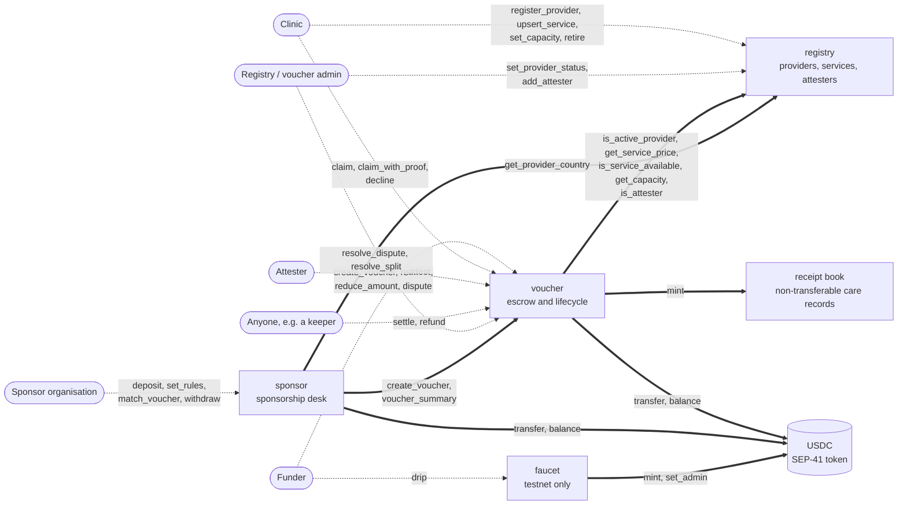

# Contract reference

Looking up an `Error(Contract, #N)`? Every code, with its meaning and what to do, is in the [error code reference](errors.md).

Three contracts. `registry` and `receipt` hold no references and deploy first; `voucher` points at both and deploys last.

All amounts are `i128` in the token's smallest unit. All timestamps are `u64` seconds since epoch.

`contracts/common` (`sci-common`) is an internal `rlib` shared by the three contracts: the TTL constants, the persistent-entry extension helper and the two-step admin handover (`propose_admin` / `take_pending_admin` / `require_admin`). It defines no contract entry points; each contract keeps its own `DataKey`, errors and events, so the public interface and the numbers callers see are unchanged. Faucet keeps its own shorter drip TTLs.

The decisions that look surprising on a first read — a provider cannot attest its own voucher, `settle` and `refund` take no signature, beneficiary references are HMACs, and there is no general balance — are recorded with their reasoning and rejected alternatives in the [architecture decision records](../adr/README.md).

Protocol terminology used across the docs is defined in [docs/glossary.md](../glossary.md). Clinic questions (payment timing, disputes, fees) are answered in [docs/guides/clinics-faq.md](../guides/clinics-faq.md), and French versions of the funder, clinic and attester guides live under [docs/fr/](../fr/).

---

## Who calls whom



Thick arrows are cross-contract calls, declared in [`contracts/voucher/src/interfaces.rs`](https://github.com/Godgift-care/sci-healthcare-contracts/blob/main/contracts/voucher/src/interfaces.rs) and [`contracts/sponsor/src/interfaces.rs`](https://github.com/Godgift-care/sci-healthcare-contracts/blob/main/contracts/sponsor/src/interfaces.rs), plus the standard token interface. Dotted arrows are calls a person or app signs; each is labelled with its main functions, and admin settings such as caps and handovers are left out. Only the voucher contract can `mint` a receipt: the receipt book names it as minter at initialisation.

## registry

Answers one question: who is allowed to do what.

### Types

```rust
pub enum ProviderStatus { Pending = 0, Active = 1, Suspended = 2, Retired = 3 }

pub enum ProviderCategory { Clinic = 0, Pharmacy = 1, Laboratory = 2, Maternity = 3, Other = 4 }

pub struct Provider {
    pub owner: Address,       // receives settlement
    pub name: String,
    pub country: String,      // ISO 3166-1 alpha-2, two ASCII uppercase letters
    pub status: ProviderStatus,
    pub registered_at: u64,
    pub reason_code: u32,     // why the last status change happened, 0 before any
    pub category: ProviderCategory,
    pub verification_evidence: Option<BytesN<32>>,
}

pub struct RegistrationDepositConfig {
    pub token: Address,
    pub amount: i128,
    pub fee_account: Address,
}

pub struct ServiceItem {
    pub code: u32,            // coarse category, never a diagnosis
    pub label: String,
    pub price: i128,
    pub active: bool,
    pub available: bool,      // false while the clinic has paused it
    pub pending_price: i128,  // scheduled price, 0 if none
    pub effective_at: u64,    // when pending_price applies, 0 if none
}
```

### Functions

| Function | Parameters | Returns | Auth | Errors |
| --- | --- | --- | --- | --- |
| `initialize` | `admin: Address` | `()` | once | `AlreadyInitialized` |
| `set_registration_deposit` | `admin, token, amount: i128, fee_account` | `()` | `admin` | `NotAuthorized`, `InvalidDepositAmount` |
| `registration_deposit` | — | `Option<RegistrationDepositConfig>` | view | — |
| `register_provider` | `owner, name, country, category: ProviderCategory` | `()` | `owner` | `EmptyName`, `InvalidCountry`, `ProviderExists`, `TokenTransferFailed`, `TokenAmountMismatch` |
| `update_provider_category` | `provider_addr, category: ProviderCategory` | `()` | `provider_addr` | `ProviderNotFound` |
| `set_provider_status` | `admin, provider_addr, status, reason_code: u32` | `()` | `admin` | `NotAuthorized`, `MissingReasonCode`, `ProviderNotFound`, `InvalidTransition`, `TokenTransferFailed`, `TokenAmountMismatch` |
| `set_verification_evidence` | `admin, provider_addr, evidence_hash: BytesN<32>` | `()` | `admin` | `NotAuthorized`, `ProviderNotFound` |
| `retire` | `owner, reason_code: u32` | `()` | `owner` | `ProviderNotFound`, `InvalidTransition`, `TokenTransferFailed`, `TokenAmountMismatch` |
| `upsert_service` | `provider_addr, code, label, price` | `()` | `provider_addr` | `InvalidPrice`, `EmptyName`, `ProviderNotActive`, `PriceIncreaseNeedsNotice` |
| `schedule_service_price` | `provider_addr, code, price, effective_at, confirm_large_change: bool` | `()` | `provider_addr` | `InvalidPrice`, `ProviderNotActive`, `ServiceNotFound`, `PriceNoticeTooShort`, `LargePriceJumpNeedsConfirmation` |
| `remove_service` | `provider_addr, code` | `()` | `provider_addr` | `ServiceNotFound` |
| `set_service_available` | `provider_addr, code, available: bool` | `()` | `provider_addr` | `ServiceNotFound` |
| `set_capacity` | `provider_addr, max_outstanding: u32` | `()` | `provider_addr` | `ProviderNotFound` |
| `add_attester` | `admin, attester` | `()` | `admin` | `NotAuthorized` |
| `remove_attester` | `admin, attester` | `()` | `admin` | `NotAuthorized` |
| `propose_admin` | `admin, new_admin` | `()` | `admin` | `NotAuthorized` |
| `accept_admin` | `new_admin` | `()` | `new_admin` | `NoPendingAdmin`, `NotAuthorized` |
| `get_pending_admin` | — | `Option<Address>` | view | — |
| `get_provider` | `provider_addr` | `Provider` | view | `ProviderNotFound` |
| `list_providers` | `start, limit: u32` | `Vec<Provider>` | view | — |
| `provider_counts` | — | `(u32, u32, u32)` | view | — |
| `providers_in` | `country: String, start, limit: u32` | `Vec<Provider>` | view | — |
| `is_active_provider` | `provider_addr` | `bool` | view | — |
| `get_service` | `provider_addr, code` | `ServiceItem` | view | `ServiceNotFound` |
| `get_services` | `provider_addr, codes: Vec<u32>` | `Vec<ServiceItem>` | view | — |
| `get_service_price` | `provider_addr, code` | `i128` | view | — |
| `get_upcoming_price` | `provider_addr, code` | `(i128, u64)` | view | `ServiceNotFound` |
| `is_service_available` | `provider_addr, code` | `bool` | view | — |
| `is_attester` | `addr` | `bool` | view | — |
| `list_attesters` | `start, limit: u32` | `Vec<Address>` | view | — |
| `get_capacity` | `provider_addr` | `u32` | view | — |
| `get_admin` | — | `Address` | view | `NotInitialized` |
| `version` | — | `String` | view | — |

`get_service_price` returns `0` when the service is absent or inactive. It exists so `voucher` can validate pricing over an interface of primitives only, without the two contracts sharing types.

`register_provider` accepts a country only in the shape of an ISO 3166-1 alpha-2 code: exactly two ASCII uppercase letters. `ng`, `N1`, two spaces and multi-byte characters are all refused with `InvalidCountry`, so the app and the indexer can never see one country registered as two, or junk codes break the country filter. Checking the code against the full ISO list is an off-chain concern.

Registration deposits are disabled by default. The admin can set the settlement
token, non-negative amount and fee account with
`set_registration_deposit(admin, token, amount, fee_account)`; an amount of
zero leaves registration unchanged. A positive amount is transferred from the
registering clinic and held until the pending application leaves that state:
activation returns it, rejection (`Pending → Suspended`) forwards it to the
configured fee account, and clinic withdrawal returns it. Each deposit keeps
the token and destination configured at registration, so changing the
configuration cannot redirect or strand an outstanding deposit. Token
transfers are checked for exact balance changes and a failed release reverts
the status transition, leaving the deposit recorded for retry.

`list_providers(start, limit)` returns providers in registration order, paged by `start` with `limit` capped at `MAX_PROVIDERS_PAGE` (50). Page by calling again with `start += returned.len()`. It is the on-chain discovery any app or auditor can use instead of trusting an indexer, and it needs no signature.

`providers_in(country, start, limit)` returns the `Active` providers registered in `country` (ISO 3166-1 alpha-2), paged the same way. Only clinics the admin has moved to `Active` appear; pending and suspended clinics stay out. The per-country index is maintained on every `set_provider_status` call that crosses the `Active` boundary, so a partner app can show local clinics without running an indexer. `limit` is capped at `MAX_PROVIDERS_PAGE`.

A clinic that temporarily cannot deliver a service (out of test kits, say) calls `set_service_available(provider_addr, code, false)` instead of delisting it. The service keeps its catalogue entry and its price, `is_service_available` returns `false`, and `voucher` refuses to fund it with `ServiceUnavailable`. Vouchers already funded against it are unaffected. `upsert_service` keeps a paused service paused; only `set_service_available(…, true)` puts it back on sale. New services are listed as available.

Price changes are scheduled, not sprung. `schedule_service_price(provider_addr, code, price, effective_at, confirm_large_change)` records a new price that takes effect at `effective_at`, which must be at least `MIN_PRICE_NOTICE_SECS` (24 hours) away or the call fails with `PriceNoticeTooShort`. A price of `MAX_PRICE_JUMP` (5) times the current price or more is rejected with `LargePriceJumpNeedsConfirmation` unless `confirm_large_change` is `true`: a fat-fingered zero would otherwise overcharge every funder that day. Until `effective_at`, `get_service_price` returns the current price and `get_upcoming_price` returns `(price, effective_at)` so apps can warn funders; from `effective_at` on, every read returns the new price — no keeper has to call in. Scheduling again replaces the earlier schedule, and scheduling the current price calls a change off. `upsert_service` still lists a new service, or lowers an existing price, at once, but rejects a rise with `PriceIncreaseNeedsNotice`; prices rise only through `schedule_service_price`, which is where the large-jump check lives. A service that is removed and listed again starts fresh, at whatever price it is listed with.

A clinic declares how many vouchers it can serve at once with `set_capacity(provider_addr, max_outstanding)`; `0` — the default — means unlimited. `voucher` counts each clinic's outstanding vouchers (funded, claimed, attested or disputed) and refuses a new one at capacity with `ProviderAtCapacity`; the count drops when a voucher settles or refunds. Lowering the capacity never affects vouchers already funded. The change emits `capacity_changed` (topic `provider`; data `max_outstanding`).

Every contract — registry, voucher, receipt and faucet — has a `version()` view returning the crate version it was built from (`CARGO_PKG_VERSION`, the workspace version, currently `0.2.0`). Use it to tell which build a deployment runs before relying on a newer function.

### Status lifecycle

A provider's status only moves where the move carries information. `set_provider_status` accepts exactly these transitions and refuses everything else with `InvalidTransition` — including setting the same status twice and the backwards `Active → Pending`, either of which would emit an event that misleads the indexer:

| From \ To | `Pending` | `Active` | `Suspended` | `Retired` |
| --- | --- | --- | --- | --- |
| `Pending` | ✗ | ✓ | ✓ | ✗ |
| `Active` | ✗ | ✗ | ✓ | ✗ |
| `Suspended` | ✗ | ✓ | ✗ | ✗ |
| `Retired` | ✗ | ✗ | ✗ | ✗ |

Every change carries a `reason_code: u32` — stored on the provider as its last reason, and published in `provider_status_changed` — so a suspended clinic knows why it was suspended and funders can tell a fraud suspension from paperwork. The codes are documented in [the trust model](../protocol/trust.md#reason-codes) and are added, never renumbered; registration records `0` before any change has happened. Because `0` means "no change yet", `set_provider_status` refuses it with `MissingReasonCode` (#16): every change an admin makes has to say why.

**Reinstatement** (`Suspended → Active`) re-opens a clinic to funding, so it gets no special path: like every other change it needs the stored admin's own signature and a non-zero reason code. The clinic itself, an attester, another clinic, a nominated admin who has not yet called `accept_admin`, and a previous admin after a handover are all refused with `NotAuthorized`. Authorisation is checked before the reason code, so a caller who is not the admin learns nothing about the provider. Each of these callers has its own test in `contracts/registry/src/test/admin.rs` (`provider_cannot_reinstate_itself`, `attester_cannot_reinstate_a_provider`, `pending_admin_cannot_reinstate_before_accepting`, `previous_admin_cannot_reinstate_after_handover`, `reinstating_with_reason_zero_is_rejected` and the rest of the `#302` block). There is no separate verifier role yet. If one is added, it should be added to this rule and to those tests.

**Retirement** is the one status the admin cannot assign. A clinic that closes calls `retire(owner, reason_code)` — its own signature only — which sets the terminal `Retired` status. A retired clinic is not an active provider, so `voucher` refuses to fund it any new vouchers; vouchers already funded against it refund as they always could (immediately, before expiry), and a voucher claimed while the clinic was active still attests and settles as care delivered. Nothing can move a retired clinic back — not the admin, not the owner — so the way back is to register again; retiring an already-retired clinic is refused with `InvalidTransition`.

### Authorisation matrix

Every public function, with the exact signer it demands — no signature that is missing, and none that is extra. The table is rendered from the `AUTH_MATRIX` list in `contracts/registry/src/test.rs`; `authorisation_matrix_matches_every_public_function` calls each row and asserts `env.auths()` holds precisely that address, and `authorisation_table_in_the_docs_matches_the_matrix` fails if this table and that list disagree.

| Function | Signer required |
| --- | --- |
| `initialize` | none (one-shot) |
| `set_registration_deposit` | `admin` |
| `registration_deposit` | none (view) |
| `register_provider` | `owner` |
| `update_provider_category` | `provider_addr` |
| `set_provider_status` | `admin` |
| `set_verification_evidence` | `admin` |
| `retire` | `owner` |
| `upsert_service` | `provider_addr` |
| `schedule_service_price` | `provider_addr` |
| `remove_service` | `provider_addr` |
| `set_service_available` | `provider_addr` |
| `set_capacity` | `provider_addr` |
| `add_attester` | `admin` |
| `remove_attester` | `admin` |
| `propose_admin` | `admin` |
| `accept_admin` | `new_admin` |
| `get_admin` | none (view) |
| `get_pending_admin` | none (view) |
| `get_provider` | none (view) |
| `list_providers` | none (view) |
| `provider_counts` | none (view) |
| `providers_in` | none (view) |
| `is_active_provider` | none (view) |
| `get_service` | none (view) |
| `get_services` | none (view) |
| `get_service_price` | none (view) |
| `get_upcoming_price` | none (view) |
| `is_service_available` | none (view) |
| `is_attester` | none (view) |
| `list_attesters` | none (view) |
| `get_capacity` | none (view) |
| `version` | none (view) |

A signer is not the same as a role: `admin` must be the stored admin **and** sign, and the two checks are ordered so a wrong `admin` argument fails before any signature is requested.

### Errors

| # | Variant |
| --- | --- |
| 1 | `AlreadyInitialized` |
| 2 | `NotInitialized` |
| 3 | `NotAuthorized` |
| 4 | `ProviderNotFound` |
| 5 | `ProviderExists` |
| 6 | `ProviderNotActive` |
| 7 | `ServiceNotFound` |
| 8 | `InvalidPrice` |
| 9 | `InvalidCountry` |
| 10 | `EmptyName` |
| 11 | `NoPendingAdmin` |
| 12 | `PriceNoticeTooShort` |
| 13 | `PriceIncreaseNeedsNotice` |
| 14 | `InvalidTransition` |
| 15 | `LargePriceJumpNeedsConfirmation` |
| 16 | `MissingReasonCode` |

### Events

| Event | Topics | Data |
| --- | --- | --- |
| `initialized` | — | `admin` |
| `provider_registered` | `provider` | `name`, `country`, `registered_at`, `category` |
| `provider_category_changed` | `provider` | `category` |
| `provider_status_changed` | `provider` | `status`, `reason_code` |
| `verification_evidence_set` | `provider` | `evidence_hash` |
| `service_upserted` | `provider`, `code` | `label`, `price` |
| `service_removed` | `provider` | `code` |
| `service_price_scheduled` | `provider`, `code` | `price`, `effective_at` |
| `service_availability_changed` | `provider`, `code` | `available` |
| `attester_added` | `attester` | — |
| `capacity_changed` | `provider` | `max_outstanding` |
| `attester_removed` | `attester` | — |

`admin_proposed` and `admin_changed` are defined once in `sci-common` and emitted by every contract that uses the two-step admin handover. See the [shared events](#shared-events-sci-common) table below.

> Fields listed under **Topics** are published in the event's topic list, **not** in its data map. The table is checked against the `#[contractevent]` structs in `contracts/registry/src/events.rs` by `event_table_in_the_docs_matches_the_source`; adding, renaming or moving a field fails that test until the table is updated in the same change.

The full schema — every topic, data field, type and the function that emits it — is in [Reading contract events](events.md).

---

## voucher

Escrow and the voucher state machine.

### Types

```rust
pub enum VoucherStatus {
    Funded = 0, Claimed = 1, Attested = 2,
    Settled = 3, Disputed = 4, Refunded = 5,
}

pub struct Voucher {
    pub id: u64,
    pub funder: Address,
    pub beneficiary_ref: BytesN<32>,   // opaque, no PHI
    pub provider: Address,
    pub service_code: u32,
    pub amount: i128,
    pub status: VoucherStatus,
    pub created_at: u64,
    pub expires_at: u64,
    pub claimed_at: u64,
    pub attested_at: u64,
    pub dispute_deadline: u64,
    pub attester: Option<Address>,     // set by `attest`, paid at settlement
    pub updated_ledger: u32,           // ledger of the last write, 0 if pre-field
}

pub struct Config {
    pub admin: Address,
    pub registry: Address,
    pub receipt_book: Address,
    pub token: Address,
    pub dispute_window: u64,
    pub fee_bps: u32,
    pub attester_share_bps: u32,       // part of fee_bps, never more
    pub fee_account: Address,
}

pub struct VoucherOptions {                       // create_voucher_with_options
    pub presence_commitment: Option<BytesN<32>>,  // sha256 of the patient's secret
    pub dispute_window: Option<u64>,              // per-voucher window, within the bounds
}

pub struct Exposure {            // a clinic's open vouchers
    pub vouchers: u32,           // funded and not yet settled or refunded
    pub value: i128,             // what they escrow in total
}
```

`Voucher` is what every function takes and returns. In storage it is kept positionally — an XDR vec of its values, without the id, which is already in the key — rather than as a map carrying every field name; for an attested voucher that is 276 bytes instead of 552, exactly half, and rent is charged on entry size (`stored_voucher_is_smaller_than_the_named_layout` prints both). Appending `updated_ledger` added 8 bytes to the stored entry (268 → 276); a voucher written before the field existed still decodes and reports `updated_ledger = 0`, meaning the ledger is unknown. `VoucherOptions` lives in its own entry, written only for a voucher that sets one.

### Functions

| Function | Parameters | Returns | Auth |
| --- | --- | --- | --- |
| `initialize` | `admin, registry, receipt_book, token, dispute_window, fee_bps, attester_share_bps, fee_account` | `()` | once |
| `create_voucher` | `funder, beneficiary_ref, provider, service_code, amount, expires_at` | `u64` | `funder` |
| `create_voucher_with_options` | `funder, beneficiary_ref, provider, service_code, amount, expires_at, options: VoucherOptions` | `u64` | `funder` |
| `create_voucher_at_price` | `funder, beneficiary_ref, provider, service_code, amount, expires_at, expected_price` | `u64` | `funder` |
| `reduce_amount` | `funder, voucher_id, new_amount` | `()` | `funder` |
| `redirect` | `funder, voucher_id, new_provider` | `()` | `funder` |
| `claim` | `provider, voucher_id` | `()` | `provider` |
| `claim_with_proof` | `provider, voucher_id, secret: Bytes` | `()` | `provider` |
| `decline` | `provider, voucher_id, reason_code` | `()` | `provider` |
| `attest` | `attester, voucher_id` | `()` | `attester` |
| `dispute` | `funder, voucher_id, reason_code` | `()` | `funder` |
| `settle` | `voucher_id` | `()` | **none** |
| `refund` | `voucher_id` | `()` | **none** |
| `resolve_dispute` | `admin, voucher_id, refund_funder: bool` | `()` | `admin` |
| `resolve_split` | `admin, voucher_id, to_provider: i128` | `()` | `admin` |
| `set_attestation_cap` | `admin, cap: u32` | `()` | `admin` |
| `set_dispute_window_bounds` | `admin, min: u64, max: u64` | `()` | `admin` |
| `set_max_escrow_per_provider` | `admin, max: i128` | `()` | `admin` |
| `set_presence_threshold` | `admin, threshold: i128` | `()` | `admin` |
| `propose_admin` | `admin, new_admin` | `()` | `admin` |
| `accept_admin` | `new_admin` | `()` | `new_admin` |
| `get_voucher` | `voucher_id` | `Voucher` | view |
| `get_voucher_options` | `voucher_id` | `VoucherOptions` | view |
| `get_dispute_window_bounds` | — | `(u64, u64)` | view |
| `refundable_at` | `voucher_id` | `u64` | view |
| `statuses` | `ids: Vec<u64>` | `Vec<(u64, VoucherStatus)>` | view |
| `get_max_escrow_per_provider` | — | `i128` | view |
| `get_presence_threshold` | — | `i128` | view |
| `get_exposure` | `provider` | `Exposure` | view |
| `get_attestation_cap` | — | `u32` | view |
| `attestations_left` | `attester` | `u32` | view |
| `get_pending_admin` | — | `Option<Address>` | view |
| `get_config` | — | `Config` | view |
| `next_voucher_id` | — | `u64` | view |
| `quote` | `amount` | `(i128, i128)` | view |
| `escrow_summary` | — | `(i128, i128)` | view |
| `version` | — | `String` | view |

`fee_bps` is capped at 1000 (10%) at initialisation. `attester_share_bps` is the part of the voucher amount paid to the attester who confirmed delivery, and must be **no greater than `fee_bps`** (`InvalidAttesterShare`, #21). It is carved out of the fee, so the clinic's net is unchanged and the payouts sum exactly to the voucher amount. Zero keeps the pre-attester-share behaviour: the fee account receives the whole fee.

`settle` and `refund` take no authorisation deliberately: a clinic that has delivered attested care must never depend on the funder or an operator to be paid. [Running a settlement keeper](keepers.md) explains how to call them for everyone.

### Authorisation matrix

Every public function, with the exact signer it demands. `AUTH_MATRIX` in `contracts/voucher/src/test.rs` drives both `authorisation_matrix_matches_every_public_function` — which calls each row and asserts `env.auths()` holds exactly that address — and this table, through `authorisation_table_in_the_docs_matches_the_matrix`.

| Function | Signer required |
| --- | --- |
| `initialize` | none (one-shot) |
| `create_voucher` | `funder` |
| `create_voucher_with_options` | `funder` |
| `create_voucher_at_price` | `funder` |
| `reduce_amount` | `funder` |
| `redirect` | `funder` |
| `claim` | `provider` |
| `claim_with_proof` | `provider` |
| `decline` | `provider` |
| `attest` | `attester` |
| `dispute` | `funder` |
| `settle` | none (permissionless) |
| `refund` | none (permissionless) |
| `resolve_dispute` | `admin` |
| `resolve_split` | `admin` |
| `set_attestation_cap` | `admin` |
| `set_dispute_window_bounds` | `admin` |
| `set_max_escrow_per_provider` | `admin` |
| `set_presence_threshold` | `admin` |
| `propose_admin` | `admin` |
| `accept_admin` | `new_admin` |
| `get_dispute_window_bounds` | none (view) |
| `get_voucher_options` | none (view) |
| `get_max_escrow_per_provider` | none (view) |
| `get_presence_threshold` | none (view) |
| `get_exposure` | none (view) |
| `get_attestation_cap` | none (view) |
| `attestations_left` | none (view) |
| `get_pending_admin` | none (view) |
| `refundable_at` | none (view) |
| `get_voucher` | none (view) |
| `statuses` | none (view) |
| `get_config` | none (view) |
| `next_voucher_id` | none (view) |
| `quote` | none (view) |
| `escrow_summary` | none (view) |
| `version` | none (view) |

`settle` and `refund` are the two permissionless rows, and that is the point:
anyone may trigger them, so a provider is never dependent on the funder or an
operator to be paid. `attest` demands an attester — and the contract separately
rejects the voucher's own provider even if it holds that role.

### What each function checks

**`create_voucher`** — amount > 0; expiry in the future; provider is `Active`; the service exists and is active; amount ≥ listed price; the service is not paused (`ServiceUnavailable`); the clinic is below the capacity it declared in the registry (`ProviderAtCapacity`); the clinic's escrow plus this amount stays within the per-clinic cap (`EscrowCapReached`); an amount above `get_presence_threshold()` carries a `presence_commitment` (`PresenceCommitmentRequired`). Transfers the token *before* writing the voucher, so a failed transfer reverts everything. The contract measures its own token balance before and after the transfer and fails with `TokenAmountMismatch` unless it rose by exactly `amount`, so a token that charges transfer fees can never fund a voucher with less than its recorded amount.

**`set_max_escrow_per_provider`** — caller is admin; `max` ≥ 0 (`InvalidEscrowCap`). `0`, the default, is unlimited. The cap limits what one clinic can hold in escrow across all its open vouchers, so a verified clinic that turns out to be fraudulent is exposed to at most this much. `get_exposure(provider)` returns the clinic's open voucher count and escrowed value; both fall when a voucher settles or refunds, including through `resolve_dispute` and `resolve_split`, and the value falls by the refunded difference when `reduce_amount` lowers a voucher. Lowering the cap only affects new vouchers.

**`create_voucher_at_price`** — the same checks, plus the registry price must equal `expected_price` at execution (`PriceChanged`). Use it when the funder was shown a quote before signing: if the clinic changed the price in between, in either direction, nothing is escrowed and the client can re-quote. The old `create_voucher` entry point is unchanged and still reads the current price; it remains suitable for callers that do not show a price first.

**`reduce_amount`** — caller is the funder of this voucher (`NotAuthorized`); status is `Funded` (`InvalidStatus`); `new_amount` > 0 (`InvalidAmount`) and strictly below the escrowed amount (`AmountNotReduced`); the service is still listed (`ServiceNotOffered`); and `new_amount` ≥ the price the registry lists **at call time** (`AmountBelowPrice`). The difference goes straight back to the funder and the escrow keeps the rest; no fee is taken on money that never became care, and the `open_escrow` total follows the difference down. The price at call time is the floor, not the price at funding time: a clinic that has raised its price cannot have a funded voucher reduced below that price, and a clinic that has lowered it frees the funder to reduce further. A voucher whose service has been delisted cannot be reduced at all — there is no floor to reduce towards — and is refunded at expiry instead. Once the clinic has claimed the voucher the amount is what the clinic expects to be paid, so the reduction is closed.

**`create_voucher_with_options`** — everything `create_voucher` checks, plus: a `dispute_window`, when set, lies within `get_dispute_window_bounds()` (`InvalidDisputeWindow`). A voucher whose amount is above the presence threshold must set `presence_commitment` (`PresenceCommitmentRequired`). With both options unset and the threshold at 0 it is exactly `create_voucher`.

**`claim`** — caller is the named provider; provider is still `Active` in the registry; status is `Funded`; not expired; the voucher has no presence commitment (`PresenceProofRequired`).

**`claim_with_proof`** — the same checks as `claim`, for a voucher funded with a `presence_commitment`: `sha256(secret)` must equal it (`InvalidPresenceProof`), and a voucher without one is `NoPresenceCommitment`. The funder gives the secret to the patient, so a claim shows the clinic had the patient in front of it rather than only saying so. The secret becomes public with the claim; it was only ever good for that voucher.

**`decline`** — caller is the named provider; status is `Funded`. Returns the full escrow to the funder immediately, with no fee, and records the clinic's `reason_code` in `voucher_declined`. The existing `voucher_refunded` event is also emitted for the refund. The indexer needs `voucher_declined: ['provider']` in `TOPIC_FIELDS` in `sci-healthcare-backend/src/stellar/events.ts`.

**`attest`** — caller is a registry attester; caller is **not** the provider; status is `Claimed`; the attester has attestations left today. Stores the attester on the voucher and sets `dispute_deadline = now + dispute_window`.

**`attest`** — caller is a registry attester; caller is **not** the provider; status is `Claimed`; the attester has attestations left today. Stores the attester on the voucher and sets `dispute_deadline = now + window`, where `window` is the voucher's own `dispute_window` if it was funded with one and `Config.dispute_window` otherwise.

**`set_dispute_window_bounds`** — caller is admin; `1 ≤ min ≤ max` (`InvalidDisputeWindow`). The range a funder's per-voucher window must fall in; `DEFAULT_DISPUTE_WINDOW_BOUNDS` is one day to thirty. Applies to vouchers funded afterwards. Emits `dispute_window_bounds_changed`.

**`set_presence_threshold`** — caller is admin; `threshold` ≥ 0 (`InvalidPresenceThreshold`). Above the threshold, a new voucher must carry a `presence_commitment`; `0`, the default, disables the protocol-level requirement, and vouchers already funded are unaffected. Emits `presence_threshold_changed { admin, threshold }`; `get_presence_threshold` reads it.

**`statuses`** — returns the current status of up to `MAX_STATUSES_PER_CALL` (50) vouchers, in the order the ids were given. Unknown ids are omitted and ids beyond the cap are ignored, so a larger wallet list is paged. It is a view and deliberately does **not** extend any voucher's TTL, unlike `get_voucher`.

**`set_attestation_cap`** — caller is admin; `cap` ≥ 1 (`InvalidAttestationCap`). Each attester may attest at most `cap` vouchers per UTC day (`timestamp / 86400`); the next is rejected with `AttestationCapReached` until midnight UTC, when the counter resets. The default is `DEFAULT_MAX_ATTESTATIONS_PER_DAY` (100). Counters live in temporary storage keyed by `(attester, day)`. The cap bounds what a stolen attester key can confirm before the admin removes it from the registry; `attestations_left(attester)` and the `remaining_today` field of `voucher_attested` show how close an attester is.

**`dispute`** — caller is the funder; status is `Claimed`, or `Attested` and before the deadline.

**`settle`** — status is `Attested`; now ≥ `dispute_deadline`; the contract still holds the voucher's amount (`EscrowShortfall` if the token issuer clawed escrow back); the token accepts the transfers (`TokenTransferFailed` if the issuer froze the escrow, the clinic or the attester). Pays the clinic `amount - fee`, the attester its share (`amount * attester_share_bps / 10_000`), and the fee account the remaining fee, then mints a receipt. The three payouts sum to `amount` exactly. If no attester is recorded — a dispute resolved for the provider without an attestation — the fee account receives the whole fee.

**`refund`** — status is `Funded` and either now ≥ `expires_at` or the provider is no longer active in the registry (so a suspended clinic's voucher is refundable immediately, before expiry), or status is `Claimed` and now ≥ `expires_at + CLAIM_GRACE_SECS` (7 days). Suspension does not shorten the claim grace: care may already have been given. Returns the full amount, no fee. `refundable_at` returns the exact time, which is the current ledger time when a funded voucher's provider is inactive. It has the same `EscrowShortfall`, `TokenTransferFailed` and `TokenAmountMismatch` checks as `settle`, and so do `resolve_dispute`, `resolve_split` and the refund in `reduce_amount`, which pay through the same paths. Every payout checks that the escrow fell by exactly the amount sent and the recipient rose by exactly that amount; otherwise it fails with `TokenAmountMismatch` (a token with transfer fees or hooks). Any of these errors reverts the whole call, so the voucher keeps its status; see [the settlement token's issuer](../protocol/trust.md#the-settlement-tokens-issuer).

**`redirect`** — caller is the funder; status is `Funded`. The replacement clinic must be active, offer the voucher's service, have it available, and list it at no more than the escrowed amount. Changes only the provider: amount, expiry and escrow are unchanged. Emits `voucher_redirected` with `funder` and `new_provider` topics and the previous provider, voucher id and service code in its data.

**`propose_admin` / `accept_admin`** — two-step handover, identical in all three contracts. Proposing again replaces the nominee; nothing changes until the nominee signs `accept_admin`. On mainnet, hand admin to a 2-of-3 Stellar multisig account rather than a single key; see [Using a multisig admin](multisig-admin.md).

**`resolve_dispute`** — caller is admin; status is `Disputed`. Routes to funder or provider; no third destination exists.

**`escrow_summary`** — a read-only solvency check returning `(open_escrow, token_balance)`. `open_escrow` is a running instance-storage total of every funded voucher that has not yet settled or refunded; it is increased by `create_voucher` and decreased by `settle`, `refund` and both outcomes of `resolve_dispute`, and by `reduce_amount` for the part that goes back to the funder. `token_balance` is the contract's real balance of the settlement token. The two are equal when the accounting is correct, so anyone can check the contract without scanning every voucher. No authorisation is required.

### Errors

| # | Variant | # | Variant |
| --- | --- | --- | --- |
| 1 | `AlreadyInitialized` | 9 | `InvalidExpiry` |
| 2 | `NotInitialized` | 10 | `InvalidStatus` |
| 3 | `NotAuthorized` | 11 | `VoucherExpired` |
| 4 | `VoucherNotFound` | 12 | `NotYetExpired` |
| 5 | `ProviderNotActive` | 13 | `DisputeWindowOpen` |
| 6 | `ServiceNotOffered` | 14 | `DisputeWindowClosed` |
| 7 | `AmountBelowPrice` | 15 | `InvalidFee` |
| 8 | `InvalidAmount` | 16 | `MathOverflow` |
|  |  | 17 | `NoPendingAdmin` |
|  |  | 18 | `ServiceUnavailable` |
|  |  | 19 | `AttestationCapReached` |
|  |  | 20 | `InvalidAttestationCap` |
|  |  | 21 | `InvalidAttesterShare` |
|  |  | 22 | `AmountNotReduced` |
|  |  | 23 | `EscrowShortfall` |
|  |  | 24 | `TokenTransferFailed` |
|  |  | 25 | `ProviderAtCapacity` |
|  |  | 26 | `EscrowCapReached` |
|  |  | 27 | `InvalidEscrowCap` |
|  |  | 28 | `PresenceProofRequired` |
|  |  | 29 | `InvalidPresenceProof` |
|  |  | 30 | `NoPresenceCommitment` |
|  |  | 31 | `InvalidDisputeWindow` |
|  |  | 32 | `PresenceCommitmentRequired` |
|  |  | 33 | `InvalidPresenceThreshold` |
|  |  | 34 | `TokenAmountMismatch` |
|  |  | 42 | `PriceChanged` |

### Events

| Event | Topics | Data |
| --- | --- | --- |
| `initialized` | — | `admin` |
| `voucher_created` | `funder`, `provider`, `beneficiary_ref` | `voucher_id`, `service_code`, `amount`, `created_at`, `expires_at` |
| `voucher_claimed` | `provider` | `voucher_id`, `claimed_at`, `service_code`, `amount` |
| `voucher_declined` | `provider` | `voucher_id`, `reason_code`, `service_code`, `amount` |
| `voucher_attested` | `attester` | `voucher_id`, `attested_at`, `dispute_deadline`, `service_code`, `amount`, `remaining_today` |
| `voucher_disputed` | `funder` | `voucher_id`, `reason_code`, `service_code`, `amount` |
| `voucher_settled` | `provider` | `voucher_id`, `net`, `fee`, `service_code`, `amount`, `attester_share` |
| `voucher_refunded` | `funder` | `voucher_id`, `amount`, `service_code` |
| `voucher_amount_reduced` | `funder` | `voucher_id`, `service_code`, `previous_amount`, `amount`, `refunded` |
| `voucher_redirected` | `funder`, `new_provider` | `voucher_id`, `previous_provider`, `service_code` |
| `dispute_resolved` | `admin` | `voucher_id`, `refunded_funder`, `to_provider`, `fee`, `to_funder` |
| `attestation_cap_changed` | `admin` | `cap` |
| `dispute_window_bounds_changed` | `admin` | `min`, `max` |
| `escrow_cap_changed` | `admin` | `max` |
`admin_proposed` and `admin_changed` are shared from `sci-common`; see the [shared events](#shared-events-sci-common) table below.

> The table is checked against the `#[contractevent]` structs in `contracts/voucher/src/events.rs` by `event_table_in_the_docs_matches_the_source`; adding, renaming or moving a field fails that test until the table is updated in the same change.
>
> Fields listed under **Topics** are published in the event's topic list, **not** in its data map. An indexer reading them off the data map gets `undefined`.
>
> The complete per-event reference, with decoded JS examples, is in [Reading contract events](events.md).
>
> Every event in this table has a snapshot test that reads the decoded XDR and asserts the exact topic list and data map — `*_event_snapshot` in each contract's `src/test.rs`. Changing a field name, moving a field between topic and data, or adding a field fails that test with a message naming `TOPIC_FIELDS` in `sci-healthcare-backend/src/stellar/events.ts`.
>
> Every lifecycle event now carries `service_code` and `amount`, appended **after** the fields each event already had, so one event says what was paid for without a storage lookup. The data map is keyed by field name (an XDR `ScMap`), and existing fields keep their positions: decoders that read by name — including `sci-healthcare-backend` — pick the new fields up without a breaking change. `voucher_refunded` already carried `amount`; it gains `service_code` only.
>
> `voucher_amount_reduced` is new, so it needs one line in the indexer: `voucher_amount_reduced: ['funder']` in `TOPIC_FIELDS` in `sci-healthcare-backend/src/stellar/events.ts`. Without it the event still decodes — the decoder falls back to no topic names — but the `funder` topic reads as `undefined`. Its data fields are read by name and need no decoder change.

---

## receipt

A non-transferable record that a care episode was funded and settled. There is deliberately no transfer function.

### Types

```rust
pub struct Receipt {
    pub voucher_id: u64,
    pub beneficiary_ref: BytesN<32>,
    pub provider: Address,
    pub service_code: u32,
    pub amount: i128,
    pub fee: i128,
    pub net: i128,
    pub settled_at: u64,
}
```

`amount` is the gross value of the vouchers, `fee` the protocol fee taken from it at settlement and `net` what the clinic received: always `net + fee == amount`. A receipt minted before these two fields existed still decodes, with `fee = 0` and `net = amount` — the gross amount was all that layout recorded.

### Functions

| Function | Parameters | Returns | Auth |
| --- | --- | --- | --- |
| `initialize` | `admin, minter` | `()` | once |
| `propose_minter` | `admin, new_minter` | `()` | `admin` |
| `accept_minter` | `new_minter` | `()` | `new_minter` |
| `mint` | `minter, voucher_id, beneficiary_ref, provider, service_code, amount, fee, net` | `()` | `minter` |
| `get_receipt` | `voucher_id` | `Receipt` | view |
| `get_receipts` | `ids` | `Vec<Receipt>` | view |
| `count_for` | `beneficiary_ref` | `u32` | view |
| `provider_stats` | `provider` | `(u32, i128)` | view |
| `totals` | — | `(u32, i128)` | view |
| `receipts_of_provider` | `provider, start, limit` | `Vec<Receipt>` | view |
| `name` | — | `String` | none (view) |
| `symbol` | — | `String` | none (view) |
| `receipt_uri` | `voucher_id` | `String` | none (view) |
| `get_minter` | — | `Address` | view |
| `get_pending_minter` | — | `Option<Address>` | view |
| `get_admin` | — | `Address` | view |
| `version` | — | `String` | view |

Only the minter — the voucher contract — may mint. Contract instances are deployed before either is initialised, so the receipt book can name the voucher contract as minter in `initialize`. Changing the minter later is a two-step handover: `propose_minter` then `accept_minter`.

Both the admin and the minter are handed over in two steps. `propose_minter(admin, new_minter)` only records a nomination and emits `minter_proposed`; `accept_minter(new_minter)` is what changes `get_minter()`. A typo in the proposed address therefore cannot hand minting rights to the wrong contract, and cannot stop receipts, because the old minter keeps working until the nominee accepts. `get_pending_minter()` shows an outstanding nomination.

Receipts are soulbound: there is deliberately no transfer function, so a receipt stays bound to the beneficiary reference it was minted against. `name`, `symbol` and `receipt_uri` are read-only wallet metadata. `receipt_uri(voucher_id)` returns `https://receipts.sci.health/v1/receipt/<voucher_id>` — the voucher id only, no patient or beneficiary data — so explorers can display the receipt without exposing any PHI.

`mint` records the settlement split as well as the gross amount: `fee` is the protocol fee and `net` is what the clinic received, so a clinic's accounts can reconcile a receipt without pairing it with the settlement event. The voucher contract passes the same three numbers it paid out, and a split that does not add up is refused with `AmountSplitMismatch` (#10).

`get_receipts(ids)` reads several receipts in one call, in the order the ids were given. Unknown ids are skipped rather than failing the whole call, and at most `MAX_RECEIPTS_PER_CALL` (50) ids are read; the rest are ignored exactly like unknown ids. A care summary therefore reads a patient's history in one simulation instead of one per receipt.

`mint` also appends the voucher id to a per-provider index, so a clinic can prove its track record to a funder or auditor without an indexer. `receipts_of_provider(provider, start, limit)` returns that clinic's receipts in mint order, newest last. `limit` is capped at `MAX_RECEIPTS_PAGE` (50); page with `start += returned.len()`. The index is keyed by provider address, so two clinics' receipts never mix, and a provider with no receipts gets an empty vector rather than an error.

**`provider_stats`** — a clinic's on-chain track record in one call: `(count, total_amount)`, the receipts minted for that provider and the sum of their amounts, read straight from `ProviderCount(provider)` and `ProviderTotal(provider)`. Exact and read-only: no signature, no indexer, and a provider with no receipts gets `(0, 0)` rather than an error. Both entries are extended on read like every other persistent entry. `mint` keeps both with **checked arithmetic** (`checked_add`): a count or total that would overflow is refused with `MathOverflow` (#9) instead of wrapping, so a clinic's record can never understate what it was paid.

**`totals`** returns the protocol-wide `(receipt_count, total_amount)` and is updated atomically by every successful `mint`. Both counters use checked arithmetic and refuse an overflowing mint with `MathOverflow` (#9). On an already-deployed instance, the aggregate starts at zero and counts mints after this change; it does not reconstruct older receipts.

**`bump(ids)`** is permissionless and extends the persistent TTL of existing receipts without changing their fields. Reading each id restores an archived entry before its TTL is extended. It accepts at most `MAX_RECEIPTS_PER_BUMP` (50) ids; larger batches fail with `BatchTooLarge` (#10), and missing ids are ignored. Split larger lists into separate calls.

### Authorisation matrix

Every public function, with the exact signer it demands. `AUTH_MATRIX` in `contracts/receipt/src/test.rs` drives both `authorisation_matrix_matches_every_public_function` and this table.

| Function | Signer required |
| --- | --- |
| `initialize` | none (one-shot) |
| `propose_minter` | `admin` |
| `accept_minter` | `new_minter` |
| `mint` | `minter` |
| `propose_admin` | `admin` |
| `accept_admin` | `new_admin` |
| `get_pending_admin` | none (view) |
| `get_pending_minter` | none (view) |
| `get_receipt` | none (view) |
| `get_receipts` | none (view) |
| `count_for` | none (view) |
| `provider_stats` | none (view) |
| `totals` | none (view) |
| `receipts_of_provider` | none (view) |
| `name` | none (view) |
| `symbol` | none (view) |
| `receipt_uri` | none (view) |
| `get_minter` | none (view) |
| `get_admin` | none (view) |
| `version` | none (view) |

### Errors

| # | Variant |
| --- | --- |
| 1 | `AlreadyInitialized` |
| 2 | `NotInitialized` |
| 3 | `NotAuthorized` |
| 4 | `ReceiptNotFound` |
| 5 | `ReceiptExists` |
| 6 | `InvalidAmount` |
| 7 | `NoPendingAdmin` |
| 8 | `NoPendingMinter` |
| 9 | `MathOverflow` |
| 10 | `AmountSplitMismatch` |

### Events

| Event | Topics | Data |
| --- | --- | --- |
| `initialized` | — | `admin` |
| `minter_proposed` | `admin` | `pending_minter` |
| `minter_changed` | — | `minter` |
| `receipt_minted` | `beneficiary_ref`, `provider` | `voucher_id`, `service_code`, `amount`, `settled_at` |

`admin_proposed` and `admin_changed` are shared from `sci-common`; see the [shared events](#shared-events-sci-common) table below.

The indexer should treat `minter_proposed` as a pending state only: `get_minter()` changes on `minter_changed`, after the nominee accepts.

The table is checked against the `#[contractevent]` structs in `contracts/receipt/src/lib.rs` by `event_table_in_the_docs_matches_the_source`; adding, renaming or moving a field fails that test until the table is updated in the same change.

## faucet (testnet only)

Lets anyone trying the demo get test USDC without a server holding the issuer key. The demo token's Stellar Asset Contract names the faucet as its admin, so `drip` can mint. **Never point it at a real asset.** `scripts/deploy-faucet.sh` refuses mainnet.

| Function | Parameters | Returns | Auth |
| --- | --- | --- | --- |
| `initialize` | `admin, token, amount, cooldown, daily_cap, lifetime_cap` | `()` | once |
| `drip` | `to` | `i128` | `to` |
| `set_drip` | `admin, amount, cooldown` | `()` | `admin` |
| `set_paused` | `admin, paused` | `()` | `admin` |
| `release_token_admin` | `admin, new_admin` | `()` | `admin` |
| `get_config` | — | `FaucetConfig` | view |
| `next_drip_at` | `to` | `u64` (0 if allowed now) | view |
| `version` | — | `String` | view |

`drip` requires the recipient's signature, so one wallet cannot drain the faucet into addresses it does not control, and each address may drip once per `cooldown`. A classic account needs a trustline for the token first; the token reports a missing one as its error `#13`.

`initialize` sets a `daily_cap` — the total base units the faucet may mint per UTC day across every address combined. The counter resets at each day boundary, and drips beyond it are rejected with `DailyCapReached`. The admin can pause the faucet with `set_paused(admin, true)` without giving up the token admin role; while paused, every `drip` is rejected with `Paused`.

`initialize` also sets a per-address `lifetime_cap`: the total base units one address may ever receive. It is tracked in a persistent counter per address and never resets, so an address at its cap is rejected with `LifetimeCapReached` even on a new UTC day. A `lifetime_cap` of `0` means unlimited; a negative value is rejected with `InvalidAmount`. The counter is TTL-extended on every read and write.

On testnet the faucet drips 50 USDC once a day: [`CCB25WG7DQ2CSNXPTOHZO2PDZ324FQPZLH3LSNCCLWYM3FEH52GEXC47`](https://stellar.expert/explorer/testnet/contract/CCB25WG7DQ2CSNXPTOHZO2PDZ324FQPZLH3LSNCCLWYM3FEH52GEXC47).

### Authorisation matrix

Every public function, with the exact signer it demands. `AUTH_MATRIX` in `contracts/faucet/src/test.rs` drives both `authorisation_matrix_matches_every_public_function` and this table, through `authorisation_table_in_the_docs_matches_the_matrix`.

| Function | Signer required |
| --- | --- |
| `initialize` | none (one-shot) |
| `drip` | `to` |
| `set_drip` | `admin` |
| `set_paused` | `admin` |
| `release_token_admin` | `admin` |
| `get_config` | none (view) |
| `next_drip_at` | none (view) |
| `version` | none (view) |

| # | Error |
| --- | --- |
| 1 | `AlreadyInitialized` |
| 2 | `NotInitialized` |
| 3 | `NotAuthorized` |
| 4 | `InvalidAmount` |
| 5 | `CoolingDown` |
| 6 | `DailyCapReached` |
| 7 | `Paused` |
| 8 | `LifetimeCapReached` |

### Events

| Event | Topics | Data |
| --- | --- | --- |
| `dripped` | `to` | `amount` |
| `drip_changed` | — | `amount`, `cooldown` |

`drip_changed` is published by `set_drip` so configuration changes are auditable. Its data map is keyed by field name; topics are unchanged.

---

## sponsor

`contracts/sponsor` - the sponsorship desk. A sponsor deposits a budget and
sets rules; whenever a voucher qualifies, the desk funds a **second voucher**
for the same care, through the voucher contract. The match is an ordinary
voucher: the clinic claims it, an attester confirms it, the funder can dispute
it, and it settles or refunds through the same code as every other voucher.
The desk only decides *whether* a match happens and what it costs the sponsor.

The sponsor's available budget is what it deposited, minus what is committed
to open matches, plus what came back from refunded matches, minus what it
withdrew. `reconcile_sponsor` (permissionless) brings a sponsor's open matches
up to date with the voucher contract, so settled matches stop counting as
open and refunded ones return to the budget.

### Rules

| Field | Meaning |
| --- | --- |
| `match_bps` | The match as a share of the voucher's amount: `10_000` is one-for-one, `20_000` two-for-one. At most `MAX_MATCH_BPS` (200,000). |
| `cap_per_voucher` | The most the sponsor adds to any one voucher. |
| `min_voucher_amount` | The least a voucher must be worth to qualify. Zero means no minimum. |
| `min_voucher_age_secs` | How long a voucher must have been funded before it qualifies (the anti-farming wait). |
| `eligible_countries` | ISO 3166-1 alpha-2 codes the clinic must be registered in. Empty means any country. |
| `eligible_service_codes` | Service codes that qualify. Empty means any service. |

**`match_voucher`** - caller is the sponsor. The desk is not paused; the
sponsor has rules; the voucher exists, is `Funded`, is not expired and has not
been matched; the sponsor did not fund it and neither did the desk (no
self-matching, no matching a match); it is old enough and large enough; the
clinic's country (`registry.get_provider_country`) and the service code are
eligible; the match (`amount * match_bps / 10_000`, capped at
`cap_per_voucher`) is not zero and fits the available budget; and the sponsor
has fewer than `MAX_OPEN_MATCHES` (20) open matches. The voucher contract then
creates the matching voucher and applies its own checks (clinic active,
service listed and not paused, amount at least the service price); a refusal
comes back as `VoucherCallFailed`. The voucher contract exposes
`voucher_summary` for this check, declared over primitives so the two
contracts share no types.

### Authorisation matrix

Every public function, with the exact signer it demands. `AUTH_MATRIX` in `contracts/sponsor/src/test.rs` drives both `authorisation_matrix_matches_every_public_function` and this table, through `authorisation_table_in_the_docs_matches_the_matrix`.

| Function | Signer required |
| --- | --- |
| `initialize` | none (one-shot) |
| `deposit` | `sponsor` |
| `set_rules` | `sponsor` |
| `match_voucher` | `sponsor` |
| `withdraw` | `sponsor` |
| `reconcile_sponsor` | none (permissionless) |
| `propose_admin` | `admin` |
| `accept_admin` | `new_admin` |
| `set_paused` | `admin` |
| `get_config` | none (view) |
| `get_sponsor` | none (view) |
| `get_rules` | none (view) |
| `available_budget` | none (view) |
| `get_match` | none (view) |
| `get_match_of` | none (view) |
| `budget_summary` | none (view) |
| `get_pending_admin` | none (view) |
| `version` | none (view) |

### Errors

| Code | Name | Code | Name |
| --- | --- | --- | --- |
| 1 | `AlreadyInitialized` | 14 | `VoucherTooNew` |
| 2 | `NotInitialized` | 15 | `VoucherTooSmall` |
| 3 | `NotAuthorized` | 16 | `MatchBelowPrice` |
| 4 | `InvalidAmount` | 17 | `BudgetExhausted` |
| 5 | `InvalidRules` | 18 | `WithdrawExceedsBudget` |
| 6 | `RulesNotSet` | 19 | `TooManyOpenMatches` |
| 7 | `VoucherNotFound` | 20 | `Paused` |
| 8 | `VoucherNotFunded` | 21 | `VoucherCallFailed` |
| 9 | `VoucherExpired` | 22 | `ProviderNotEligible` |
| 10 | `AlreadyMatched` | 23 | `ServiceUnavailable` |
| 11 | `SelfMatchNotAllowed` | 24 | `MatchTooSmall` |
| 12 | `CountryNotEligible` | 25 | `MathOverflow` |
| 13 | `ServiceNotEligible` | 26 | `NoPendingAdmin` |

### Events

| Event | Topics | Data |
| --- | --- | --- |
| `initialized` | - | `admin` |
| `budget_deposited` | `sponsor` | `amount`, `available` |
| `rules_set` | `sponsor` | `match_bps`, `cap_per_voucher`, `min_voucher_amount`, `min_voucher_age_secs` |
| `match_created` | `sponsor`, `original_voucher_id` | `matched_voucher_id`, `provider`, `service_code`, `amount`, `matched_at` |
| `match_settled` | `sponsor` | `matched_voucher_id`, `amount` |
| `match_refunded` | `sponsor` | `matched_voucher_id`, `amount` |
| `budget_withdrawn` | `sponsor` | `amount`, `available` |

`admin_proposed` and `admin_changed` are shared from `sci-common`; see the [shared events](#shared-events-sci-common) table below.

These events are new to the indexer: `sci-healthcare-backend` decodes them
once their topic names are added to `TOPIC_FIELDS` in `src/stellar/events.ts`.
The table is checked against the `#[contractevent]` structs in
`contracts/sponsor/src/events.rs` by `event_table_in_the_docs_matches_the_source`;
adding, renaming or moving a field fails that test until the table is updated in
the same change.

---

## Shared events (sci-common)

The two admin-handover events are defined once in `contracts/common/src/lib.rs`
and emitted by every contract that uses the two-step handover (`registry`,
`voucher`, `receipt`, and `sponsor`). Moving the definition to `sci-common`
means five copies cannot drift apart, and an indexer needs only one decoder for
both events across all contracts.

| Event | Topics | Data |
| --- | --- | --- |
| `admin_proposed` | `admin` | `pending_admin` |
| `admin_changed` | — | `new_admin` |

The topics and data are byte-identical to the per-contract definitions they
replaced, so existing indexers and event decoders need no change.

---

## Runnable example

[`examples/lifecycle.ts`](../../examples/lifecycle.ts) runs the whole lifecycle against testnet — registers and activates a clinic, lists its service, funds a voucher, claims, attests, waits out the dispute window, settles, and prints the minted receipt — using `@stellar/stellar-sdk` and local keys. Contract ids come from `deployments/testnet.env`. See the README section "Run the lifecycle in TypeScript"; CI type-checks the script.

---

## Storage lifetime (TTL)

Soroban does not keep an entry forever. Every persistent entry carries a
*time to live* measured in ledgers, and an entry that runs out is archived: it
leaves the live ledger, and the next caller that needs it has to restore it
first. At roughly five seconds per ledger, 17,280 ledgers is a day.

Every contract extends the TTL of what it touches, so what is in normal use
stays in the live ledger. These are the numbers, all in ledgers:

| Entry | Durability | Extended when | Threshold | Extend to |
| --- | --- | --- | --- | --- |
| Contract instance (config, admin, id counter) — all contracts | instance | every write | 7 days | 30 days |
| `RegistrationDepositConfig` (registry) | instance | every registry write and deposit-config read | 7 days | 30 days |
| `Voucher(id)` | persistent | every read and write | 30 days | 90 days |
| `Provider`, `Service`, `Attester`, `RegistrationDeposit(owner)` | persistent | every read and write | 30 days | 90 days |
| `Receipt(id)`, `Count(beneficiary_ref)` | persistent | every read and write | 30 days | 90 days |
| `ProviderCount(provider)`, `ProviderTotal(provider)`, `ProviderReceipt(provider, index)` | persistent | every mint, and `receipts_of_provider` / `provider_stats` reads | 30 days | 90 days |
| `TotalCount`, `TotalAmount` (receipt) | instance | every receipt mint and `totals` read | 7 days | 30 days |
| Sponsor `Sponsor(address)`, `Match(id)`, `OriginalOf(id)` | persistent | every read and write | 30 days | 90 days |
| Faucet `LastDrip(address)` | temporary | every drip | 1 day | 7 days |
| Faucet `LifetimeDripped(address)` | persistent | every drip and lifetime-cap read | 30 days | 90 days |

"Extended when" is a threshold, not a refresh on every call: the TTL is only
pushed back out once the remaining life drops below the threshold. A read on
day 10 of a 90-day entry does nothing; a read on day 61 of the same entry
resets it to 90 days.

### What happens to an entry nobody touches

**A voucher that is never read, claimed or refunded has lapsed by day 90.**
The contract instance around it may still be alive — other vouchers keep that
extended — but the voucher's own entry is gone from the live ledger. The money
is not lost and the voucher is not invalidated. Since protocol 23 a lapsed
persistent entry is *restored* rather than refused: the read that needs it
recreates it from the archive, and the entry comes back with the network's
minimum persistent TTL (`4096` ledgers in the test environment) before the
contract's own read path extends it again.

That restore is not free. The caller pays a restore fee, and on a real network
the RPC has to include the entry in the transaction's restore set. So the
practical rule for a funder who funded a voucher and forgot about it for three
months: the refund still works, but it costs a little more. `scripts/` and the
app should read a voucher before operating on it rather than after.

These expectations are tested, not assumed:

- `contracts/voucher/src/test.rs` — `live_voucher_survives_sixty_days_of_activity`,
  `settled_voucher_and_its_receipt_survive_sixty_days_of_activity`,
  `abandoned_voucher_is_restored_and_still_refunds`,
  `contract_instance_survives_sixty_days_of_writes` and
  `writes_extend_the_contract_instance`.
- `contracts/registry/src/test.rs` — `provider_service_and_attester_survive_sixty_days_of_activity`
  and `registry_reads_restore_a_lapsed_entry`.
- `contracts/receipt/src/test.rs` — `receipt_survives_sixty_days_of_activity`,
  `receipt_read_restores_a_lapsed_entry` and `count_for_extends_its_own_entry`.

### Storage read and write costs

Every public entry point has a committed read and write count in
`contracts/<crate>/storage-counts.md`. The count comes from running the same
`AUTH_MATRIX` case as the authorisation test once in the state that makes the
call valid, then reading `memory_read_entries` and `write_entries` from
`Env::cost_estimate().resources()`.

| Contract | Table |
| --- | --- |
| registry | [`contracts/registry/storage-counts.md`](../../contracts/registry/storage-counts.md) |
| voucher | [`contracts/voucher/storage-counts.md`](../../contracts/voucher/storage-counts.md) |
| receipt | [`contracts/receipt/storage-counts.md`](../../contracts/receipt/storage-counts.md) |
| sponsor | [`contracts/sponsor/storage-counts.md`](../../contracts/sponsor/storage-counts.md) |
| faucet | [`contracts/faucet/storage-counts.md`](../../contracts/faucet/storage-counts.md) |

The tests fail on any change, including a decrease: the committed table would
otherwise stop describing the code. Regenerate intentionally with:

```bash
just storage-counts
# or: ./scripts/refresh-storage-counts.sh
```

Explain a changed count in the pull request. An increase is a fee and
entry-limit regression, and a decrease is a cost improvement worth recording.

### Stored-type upgrade safety

Entries written by one release may outlive the release that wrote them. Each
contract keeps XDR fixtures for the `#[contracttype]` values it stores under
`contracts/<crate>/fixtures/stored_types/`. The
`stored_type_fixtures_decode_against_current_code` test decodes each fixture
with the current types and compares it with a freshly built value.

Adding, removing, renaming or reordering a field makes the old fixture fail to
decode (or decode to a different value). That is a breaking storage change: keep
the old layout, put new fields under a new data key with a default, or add a
versioned migration before refreshing the fixture. Refreshing is deliberately
explicit and should happen only at release time:

```bash
just stored-type-fixtures
# or: ./scripts/refresh-stored-type-fixtures.sh
```

The same tests honour `UPDATE_STORAGE_COUNTS=1` and
`UPDATE_STORED_TYPE_FIXTURES=1` when run directly with `cargo test`.

---

## Building, releasing and verifying the contracts

### The build

`scripts/build-wasm.sh` is the build. The release workflow, `scripts/deploy.sh`
and `scripts/verify-deployments.sh` all call it, so the wasm that is released,
the wasm that is deployed and the wasm a verifier builds are the same bytes.

```bash
./scripts/build-wasm.sh          # writes dist/*.wasm and dist/SHA256SUMS
```

Four rules make that possible, and every one of them is a trap if it is
ignored:

| Rule | Why |
| --- | --- |
| The toolchain is pinned in `rust-toolchain.toml` (1.96.0) | a different rustc emits different code |
| The release profile is fixed in the workspace `Cargo.toml` (`opt-level = "z"`, `lto = true`, `codegen-units = 1`, `panic = "abort"`, `strip = "symbols"`) | different flags mean different bytes |
| The **whole workspace** is built in one cargo invocation | cargo unifies features per package, so `cargo build -p sci-registry` links a different `soroban-sdk` than `cargo build` and produces different bytes |
| The cargo registry path is remapped out of the artefact (`--remap-path-prefix`) | the Soroban SDK embeds the absolute path of its own source in its panic messages, so without this the wasm carries the builder's home directory |
| The result is optimised with `wasm-opt -Oz` (binaryen 133) | the release pins the optimiser version, so the optimised bytes do not change under us |

**What "reproducible" covers.** Two builders that use the same toolchain, the
same profile and the same host platform get the same bytes: the same source
built in two different directories, and inside the pinned `rust:1.96.0`
container, both produce identical wasm. It does **not** cover a build on a
different operating system: some dependencies in the tree behave differently
when they are compiled on Windows, which changes the order of a few internal
helper functions in the wasm.

**What is on testnet today.** The contracts on testnet were deployed from an
older commit, built on the maintainer's Windows machine before this recipe
existed. They carry that machine's paths, so a fresh build does not reproduce
their bytes even though it exposes exactly the same interface. The voucher is
further behind: its lifecycle events do not carry `service_code` and `amount`
yet, so the deployed voucher is not the one in this repository. Redeploying
with `./scripts/deploy.sh testnet --force` fixes both.

### Deploying safely

`scripts/deploy.sh` refuses to replace an existing
`deployments/<network>.env` unless you pass `--force`, because replacing live
addresses breaks every app and indexer pointed at them. Preview first:

```bash
./scripts/deploy.sh testnet --dry-run   # prints every command, sends nothing
./scripts/deploy.sh testnet             # first deployment
./scripts/deploy.sh testnet --force     # intentional replacement
```

The dry run does not build, call `stellar`, write the env file or send a
transaction. It prints the commands with visible placeholders for the ids it
would discover. `scripts/test-deploy.sh` exercises the refusal, `--force` and
`--dry-run` paths without a network.

`deploy.sh` is a **testnet** tool: it deploys a test USDC asset from the
`$ISSUER` identity. It is not the mainnet deployment procedure. Do not point it
at mainnet; use the reviewed process in the [mainnet launch checklist](mainnet-checklist.md).

### Operating a deployment

Three scripts cover what happens after `deploy.sh`. Each reads `deployments/<network>.env`, and each was run against a local `stellar/quickstart` node.

**Rotating the admin** — `./scripts/rotate-admin.sh <network> <new-admin-identity>` hands registry, voucher and receipt to a new key in the two steps each contract requires: the current admin (`ADMIN`, default `sci-admin`) proposes on all three, then the new key accepts on all three. A preflight reads every admin first and refuses to start if any is neither the current nor the new key. The script stops at the first failed call; nothing changes until `accept_admin`, so a stop leaves the old admin in charge and a re-run picks up where it stopped. It reads each admin back, prints a summary and records the new `ADMIN_ADDRESS` in the env file. `--dry-run` prints the commands without sending anything. The faucet keeps its own admin. For a multisig admin, see [Using a multisig admin](multisig-admin.md).

**Checking the wiring** — `./scripts/verify-deployment.sh [network] [--env-file FILE]` reads each contract's configuration through read-only simulations and checks it against the env file: the voucher's `registry`, `receipt_book`, `token`, `admin`, `fee_bps`, `fee_account` and `dispute_window`, the receipt book's minter (the voucher) and admin, the registry's admin, and the faucet's token when there is one. Every check prints `PASS` or `FAIL` and any failure exits non-zero. Expected fee, window and fee account default to what `deploy.sh` uses (`FEE_BPS`, `DISPUTE_WINDOW`, `FEE_ACCOUNT` override them). This is the wiring check; `verify-deployments.sh` is the bytecode check, and a deployment should pass both.

**Seeding at volume** — `./scripts/seed-large.sh <network> <clinics> <vouchers>` registers and activates clinics across ten countries with three services each, then funds vouchers cycling through every state: Funded, Claimed, Attested, Settled, Disputed and Refunded. Clinic and funder identities (`sci-large-clinic-N`, `sci-large-funder-N`) are created once and reused, and an already-registered clinic is skipped. Settled and Refunded need the dispute window and an expiry to pass; the script waits up to `MAX_WAIT` (300 s), so on a local node deploy with `DISPUTE_WINDOW=30` to get every state. It reads every voucher back and prints the count per state. It refuses to run against mainnet.

### Integrating from another app

Wallets and remittance apps can call the contracts directly. The
[integration guide](integration.md) has runnable JavaScript for deriving a
beneficiary reference, quoting the fee, funding a voucher, reading its status
and reading receipts.

### The release

Pushing a `v*` tag runs `.github/workflows/release.yml`, which tests, builds
and attaches to the GitHub release:

- `sci_registry.wasm`, `sci_voucher.wasm`, `sci_receipt.wasm`, `sci_faucet.wasm` — the optimised contracts,
- `sci_registry.json`, `sci_voucher.json`, `sci_receipt.json`, `sci_faucet.json` — each contract's interface spec, exported from the released wasm with `stellar contract info interface --wasm <file> --output json`. It is the same interface the host exposes, so bindings can be generated and a deployment checked without building or downloading the wasm. `scripts/export-specs.sh` does the export and rewrites `SHA256SUMS` to cover the specs,
- `SHA256SUMS` — the SHA-256 of every file, wasm and specs,
- release notes that explain how to compare the hash with a deployed contract.

Comparing a deployed contract with a release is one command:

```bash
stellar contract info hash --contract-id <CONTRACT_ID> --network testnet
grep sci_voucher.wasm SHA256SUMS
```

The two hashes must be identical. The released interface spec compares the
same way, without a local build:

```bash
stellar contract info interface --contract-id <CONTRACT_ID> \
  --network testnet --output json > deployed.json
diff deployed.json sci_voucher.json
```

To rebuild the specs from a local build, run `./scripts/export-specs.sh` after
`./scripts/build-wasm.sh`; it needs the Stellar CLI and writes
`dist/sci_<contract>.json` next to each wasm.

### The check

```bash
./scripts/verify-deployments.sh testnet
```

For every contract in `deployments/testnet.env` the script fetches the
deployed wasm with `stellar contract fetch` and compares it with the local
build twice:

- **hash** — the SHA-256 of the whole file. Equal hashes mean the deployed
  bytes are the bytes this source produces.
- **interface** — the contract interface (functions, types, errors and events)
  as the Stellar host reads it, through `stellar contract info interface`.
  Equal interfaces mean the deployed contract behaves like the source even when
  the bytes differ.

The script exits non-zero when either differs. `--wasm-dir DIR` compares
against wasm files you already have (the artefacts from a release, for
example) instead of building; `--skip-build` reuses what is already in that
directory.

### Coverage

CI measures coverage with `cargo llvm-cov` and fails when it drops. The
contract sources are at **98.14% of lines** and **96.01% of regions**; the
thresholds in `.github/workflows/ci.yml` sit just under, at 98% and 95%. Test
files are excluded from the measurement: the number that matters is how much of
the contract code the tests reach. Raise the threshold in the same pull
request that adds the tests.

`just coverage` runs the same check locally, with the same exclusions and
thresholds (install `cargo-llvm-cov` 0.9.1 and the `llvm-tools-preview`
component first):

```bash
rustup component add llvm-tools-preview
cargo install --locked cargo-llvm-cov --version 0.9.1
just coverage
```

### Dependencies

`cargo deny check` runs in CI against the policy in `deny.toml`: the RustSec
advisory database, the licence allow list, the duplicate and wildcard bans and
the source allow list. There are no exceptions today. If one is needed, it has
to carry a reason:

```toml
[advisories]
ignore = [{ id = "RUSTSEC-0000-0000", reason = "why this does not apply" }]
```

Run it locally with:

```bash
cargo install --locked cargo-deny --version 0.20.2
cargo deny check
```

### Before mainnet

The contracts are unaudited and have only run on testnet. The
[mainnet launch checklist](mainnet-checklist.md) lists the code, key,
parameter, monitoring, communication and rollback gates, each with an owner and
the evidence required. Do not deploy to mainnet until it is signed off.
