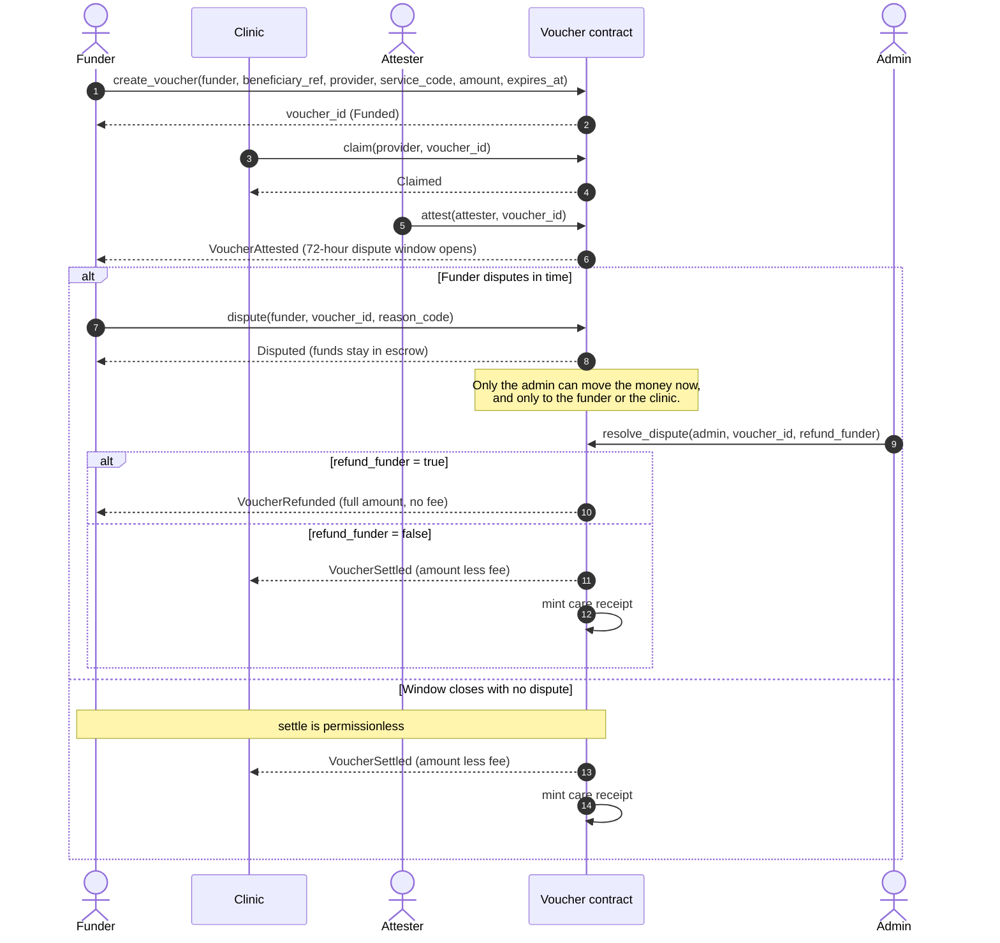

# Fonctionnement d'un bon

Un bon est un engagement unique de payer une clinique pour une prestation. Il traverse un ensemble fixe d'états, et chaque transition est un appel au contrat qu'une personne précise est autorisée à effectuer.

```
                 claim              attest             settle
  Funded ──────────────> Claimed ───────────> Attested ────────> Settled
    │                       │                     │
    │ refund                │ dispute             │ dispute
    │ (expired or           ▼                     ▼
    │  clinic inactive)  Disputed <───────────────┘
    ▼                       │
 Refunded  <──── resolve ────┴──── resolve ────> Settled
    ▲
    └── refund (Claimed, never attested, 7 days past expiry)
```

`Settled` et `Refunded` sont terminaux. Rien n'en sort.

## Les états

### Funded

Le financeur a appelé `create_voucher`. Des USDC ont été transférés de son compte vers le contrat. Le bon enregistre la clinique, le code de prestation, le montant, une date d'expiration et une référence de bénéficiaire opaque.

Avant d'accepter l'argent, le contrat vérifie trois choses : la clinique est `Active` dans le registre, elle propose bien cette prestation, et le montant est au moins égal au prix affiché. Si l'une échoue, rien ne bouge.

**Qui peut agir :** la clinique peut `claim`. Après l'expiration, n'importe qui peut `refund` ; si la clinique n'est plus active dans le registre, n'importe qui peut rembourser immédiatement, avant l'expiration.

### Claimed

Le patient s'est présenté et la clinique a appelé `claim`. C'est la clinique qui dit « cette personne est devant moi », pas « j'ai été payée ».

Un bon ne peut pas être réclamé après son expiration, et une clinique suspendue depuis le financement du bon ne peut pas le réclamer du tout.

**Qui peut agir :** un attesteur peut `attest`. Le financeur peut `dispute`. Si aucune attestation n'arrive, n'importe qui peut `refund` une fois que le bon a sept jours de retard sur son expiration — le délai de grâce après réclamation. Une suspension ne raccourcit pas ce chemin, car les soins ont peut-être déjà été dispensés.

Le délai de grâce existe pour qu'une réclamation seule ne puisse jamais retenir l'argent du financeur en otage. Sept jours laissent à un attesteur lent le temps de confirmer des soins dispensés juste avant l'expiration ; ensuite, l'argent rentre.

### Attested

Un attesteur a confirmé que les soins ont été dispensés. Cela ouvre la fenêtre de litige — 72 heures dans la configuration de production. Le bon enregistre cet attesteur, car le règlement lui verse une part des frais du protocole.

Le contrat refuse cet appel venant de la clinique qui va être payée.

**Qui peut agir :** le financeur peut `dispute` jusqu'à la fermeture de la fenêtre. Une fois fermée, n'importe qui peut `settle`.

### Settled

La fenêtre de litige s'est fermée et `settle` a été exécuté. La clinique a reçu le montant moins les frais du protocole, l'attesteur a reçu sa part configurée des frais, le reste est allé au compte de frais, et un reçu de soins a été émis. Le net de la clinique est le même qu'une part d'attesteur soit configurée ou non, et les trois paiements totalisent exactement le montant du bon.

`settle` ne demande aucune autorisation. C'est délibéré : une clinique qui a dispensé des soins et a été attestée ne devrait jamais avoir à courir après le financeur, ou nous, pour être payée.

### Disputed

Le financeur a contesté la réclamation. Les fonds restent sous séquestre jusqu'à ce que l'administrateur tranche en faveur d'une partie. L'administrateur ne peut pas envoyer l'argent ailleurs.

Un litige porte un `reason_code`. Le contrat le stocke et l'émet sans l'interpréter ; l'application, l'indexeur et ceux qui tranchent les litiges partagent cette convention :

| Code | Signification |
| --- | --- |
| 1 | Le patient n'a pas été vu |
| 2 | Les soins n'ont pas été dispensés comme décrit |
| 3 | Une autre prestation a été fournie |
| 4 | Autre chose |

De nouveaux codes peuvent être ajoutés. Les codes existants ne sont jamais renumérotés.

### Refunded

Le bon a expiré sans être réclamé, la clinique n'était plus active avant qu'il puisse l'être, il a été réclamé mais jamais attesté dans le délai de grâce, ou un litige a été tranché en faveur du financeur. Le montant **total** est rendu — aucun frais n'est prélevé sur des soins qui n'ont pas eu lieu.

## Le déroulé d'un litige

Chacun a un rôle fixe dans un litige, et seul l'administrateur peut déplacer l'argent une fois le litige ouvert :



Un financeur peut aussi ouvrir un litige juste après `claim`, avant toute attestation : `dispute` accepte un bon en `Claimed`. La même séquence s'applique alors, l'administrateur tranchant.

Si la clinique réclame mais qu'aucun attesteur ne confirme jamais la prestation, la fenêtre de litige ne s'ouvre jamais. À la place, `refund` permet à n'importe qui de rendre le montant total au financeur une fois que le bon a sept jours de retard sur son expiration (`CLAIM_GRACE_SECS`). La clinique ne peut pas garder l'argent en restant silencieuse.

## Un exemple concret

Amina, qui travaille à Londres, veut couvrir la visite prénatale de sa mère dans une clinique de Lagos.

1. Elle ouvre l'application, trouve la clinique et choisit « Visite prénatale — 5,00 $ ».
2. Elle saisit le numéro de carte de clinique de sa mère et une clé secrète. Son navigateur les transforme en une référence opaque de 32 octets. Ni le numéro de carte ni la clé ne quittent son appareil.
3. Elle signe une transaction. 5,00 $ USDC entrent dans le contrat, liés à cette clinique, cette prestation et une expiration à 30 jours.
4. Sa mère se présente. La clinique appelle `claim`.
5. Un agent de santé communautaire enregistré comme attesteur confirme que la visite a eu lieu.
6. 72 heures passent sans litige.
7. N'importe qui appelle `settle`. La clinique reçoit 4,95 $. Le protocole garde 0,05 $.
8. Un reçu de soins est émis contre la référence du bénéficiaire. La mère d'Amina dispose désormais d'une preuve vérifiable que ces soins ont été payés, sans aucune information clinique attachée.

Si sa mère ne se présente jamais, au bout de 30 jours Amina appelle `refund` et récupère les 5,00 $ en totalité.
