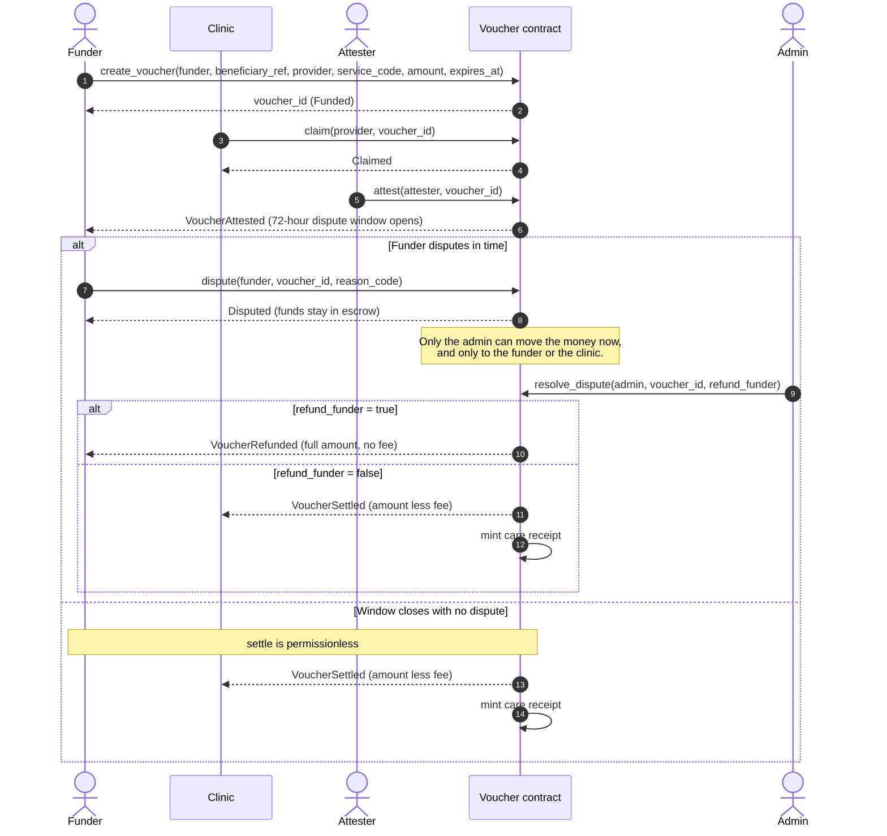

# How a voucher works

A voucher is one commitment to pay one clinic for one service. It moves through a fixed set of states, and every transition is a contract call that someone specific is authorised to make.

```
                 claim              attest             settle
  Funded ──────────────> Claimed ───────────> Attested ────────> Settled
    │                       │                     │
    │ refund                │ dispute             │ dispute
    │ (expired or           ▼                     ▼
    │  clinic inactive)  Disputed <───────────────┘
    ▼                       │
 Refunded  <──── resolve ────┴──── resolve ────> Settled
    ▲
    └── refund (Claimed, never attested, 7 days past expiry)
```

`Settled` and `Refunded` are terminal. Nothing leaves them.

## The states

### Funded

The funder has called `create_voucher`. USDC has moved from their account into the contract. The voucher records the clinic, the service code, the amount, an expiry, and an opaque beneficiary reference.

Before accepting the money the contract checks three things: the clinic is `Active` in the registry, the clinic actually offers that service, and the amount is at least the listed price. If any fails, nothing moves.

**Who can act:** the clinic can `claim`. After expiry, anyone can `refund`; if the clinic is no longer active in the registry, anyone can refund at once, before expiry.

### Claimed

The patient turned up and the clinic called `claim`. This is the clinic saying "this person is in front of me", not "I have been paid".

A voucher cannot be claimed after it expires, and a clinic that has been suspended since the voucher was funded cannot claim it at all.

**Who can act:** an attester can `attest`. The funder can `dispute`. If no attestation arrives, anyone can `refund` once the voucher is seven days past its expiry — the claim grace period. A suspension does not shorten this path, because care may already have been given.

The grace period exists so that a claim on its own can never hold the funder's money hostage. Seven days gives a slow attester time to confirm care that happened just before expiry; after that, the money goes home.

### Attested

An attester has confirmed the care was delivered. This starts the dispute window — 72 hours in the production configuration.

The contract refuses this call from the clinic that is going to be paid.

**Who can act:** the funder can `dispute` until the window closes. After it closes, anyone can `settle`.

### Settled

The dispute window closed and `settle` ran. The clinic received the amount less the protocol fee, the fee went to the fee account, and a care receipt was minted.

`settle` takes no authorisation. This is deliberate: a clinic that has delivered care and been attested should never have to chase the funder, or us, to be paid.

### Disputed

The funder contested the claim. Funds stay in escrow until the admin resolves it in favour of one party or the other. The admin cannot send the money anywhere else.

A dispute carries a `reason_code`. The contract stores and emits it without interpreting it; the app, the indexer and whoever resolves disputes share this convention:

| Code | Meaning |
| --- | --- |
| 1 | The patient was not seen |
| 2 | Care was not delivered as described |
| 3 | A different service was provided |
| 4 | Something else |

New codes may be added. Existing codes are never renumbered.

### Refunded

The voucher expired unclaimed, the clinic was no longer active before it could be claimed, it was claimed but never attested within the grace period, or a dispute was resolved in the funder's favour. The **full** amount goes back — no fee is taken on care that did not happen.

## The dispute sequence

Everyone in a dispute has a fixed part to play, and only the admin can move the money once it is disputed:



A funder may also open a dispute straight after `claim`, before any attestation: `dispute` accepts a voucher in `Claimed`. The same sequence then applies, with the admin resolving it.

If the clinic claims but no attester ever confirms delivery, the dispute window never opens. Instead, `refund` lets anyone return the full amount to the funder once the voucher is seven days past its expiry (`CLAIM_GRACE_SECS`). The clinic cannot keep the money by staying silent.

## A worked example

Amina, working in London, wants to cover her mother's antenatal visit at a clinic in Lagos.

1. She opens the app, finds the clinic, and picks "Antenatal visit — $5.00".
2. She enters her mother's clinic card number and a secret key. Her browser turns these into an opaque 32-byte reference. Neither the card number nor the key ever leaves her device.
3. She signs one transaction. $5.00 USDC moves into the contract, bound to that clinic, that service, and an expiry 30 days out.
4. Her mother attends. The clinic calls `claim`.
5. A community health worker registered as an attester confirms the visit happened.
6. 72 hours pass with no dispute.
7. Anyone calls `settle`. The clinic receives $4.95. The protocol keeps $0.05.
8. A care receipt is minted against the beneficiary reference. Amina's mother now has verifiable proof that this care was paid for, with no clinical information attached to it.

If her mother never attends, after 30 days Amina calls `refund` and gets the full $5.00 back.
