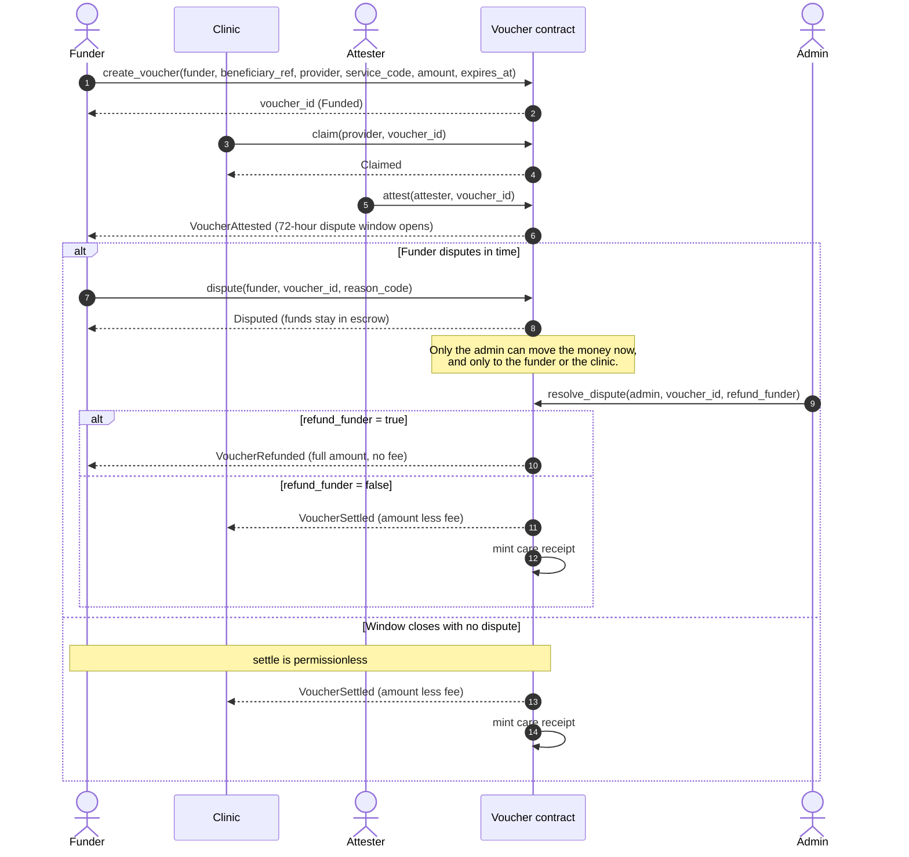

# Vocha inavyofanya kazi

🇬🇧 [Soma ukurasa huu kwa Kiingereza](../../protocol/lifecycle.md) · 🇫🇷 [Lire cette page en français](../../fr/protocol/lifecycle.md)

Vocha ni ahadi moja ya kumlipa kliniki moja kwa huduma moja. Inapita katika mfululizo maalum wa hali, na kila mabadiliko ni wito wa mkataba ambao mtu maalum ameidhinishwa kuufanya.

```
                 claim              attest             settle
  Funded ──────────────> Claimed ───────────> Attested ────────> Settled
    │                       │                     │
    │ refund                │ dispute             │ dispute
    │ (expired or           ▼                     ▼
    │  clinic inactive)  Disputed <───────────────┘
    ▼                       │
 Refunded  <──── resolve ────┴──── resolve ────> Settled
    ▲
    └── refund (Claimed, never attested, 7 days past expiry)
```

`Settled` na `Refunded` ni hali za mwisho. Hakuna kinachotoka humo.

## Hali

### Funded

Mfadhili ameita `create_voucher`. USDC zimehamishwa kutoka akaunti yake hadi kwenye mkataba. Vocha inarekodi kliniki, msimbo wa huduma, kiasi, tarehe ya mwisho, na kumbukumbu isiyoeleweka ya mnufaika.

Kabla ya kupokea pesa, mkataba hukagua mambo matatu: kliniki iko `Active` kwenye sajili, kliniki inatoa huduma hiyo kweli, na kiasi si chini ya bei iliyoorodheshwa. Yoyote ikishindikana, hakuna kinachohamishwa.

**Nani anaweza kuchukua hatua:** kliniki inaweza `claim`. Baada ya tarehe ya mwisho, mtu yeyote anaweza `refund`; ikiwa kliniki haiko active kwenye sajili, mtu yeyote anaweza kurejesha mara moja, kabla ya tarehe ya mwisho.

### Claimed

Mgonjwa alifika na kliniki ikaita `claim`. Hii ni kliniki kusema "mtu huyu yuko mbele yangu", si "nimelipwa".

Vocha haiwezi kudaiwa baada ya tarehe yake ya mwisho, na kliniki iliyosimamishwa tangu vocha ilipofadhiliwa haiwezi kuidaia kabisa.

**Nani anaweza kuchukua hatua:** mthibitishaji anaweza `attest`. Mfadhili anaweza `dispute`. Ikiwa hakuna uthibitisho unafika, mtu yeyote anaweza `refund` vocha ikiwa siku saba baada ya tarehe yake ya mwisho — kipindi cha rehema cha dai. Kusimamishwa hakufupishi njia hii, kwa sababu huduma inaweza kuwa ilitolewa tayari.

Kipindi cha rehema kipo ili dai peke yake lisiweze kuzuia pesa za mfadhili milele. Siku saba zinampa mthibitishaji wa polepole muda wa kuthibitisha huduma iliyotolewa kabla tu ya tarehe ya mwisho; baada ya hapo, pesa zinarudi nyumbani.

### Attested

Mthibitishaji amethibitisha kuwa huduma ilitolewa. Hii inaanzisha kipindi cha mgogoro — saa 72 katika usanidi wa uzalishaji. Vocha inamrekodi mthibitishaji huyo, kwa sababu malipo yanamlipa sehemu ya ada ya itifaki.

Mkataba unakataa wito huu kutoka kwa kliniki ambayo itakuwa inalipwa.

**Nani anaweza kuchukua hatua:** mfadhili anaweza `dispute` hadi kipindi kifungwe. Baada ya kufungwa, mtu yeyote anaweza `settle`.

### Settled

Kipindi cha mgogoro kilifungwa na `settle` ikaendeshwa. Kliniki ilipokea kiasi kikiondoa ada ya itifaki, mthibitishaji alipokea sehemu yake iliyosanidiwa ya ada, ada iliyobaki ilikwenda kwenye akaunti ya ada, na risiti ya huduma ilitolewa. Mapato halisi ya kliniki ni yale yale iwe sehemu ya mthibitishaji imesanidiwa au la, na malipo matatu yanajumlisha kiasi cha vocha kwa usahihi.

`settle` haihitaji idhini. Hii ni kwa makusudi: kliniki iliyotoa huduma na kuthibitishwa haipaswi kumfuata mfadhili, au sisi, ili ilipwe.

### Disputed

Mfadhili alipinga dai. Pesa zinabaki kwenye escrow hadi msimamizi aamue kwa upande mmoja. Msimamizi hawezi kutuma pesa mahali pengine popote.

Mgogoro una `reason_code`. Mkataba huihifadhi na kuichapisha bila kuifasiri; programu, indexer na yeyote anayetatua migogoro wanashiriki mkataba huu:

| Msimbo | Maana |
| --- | --- |
| 1 | Mgonjwa hakuonekana |
| 2 | Huduma haikutolewa kama ilivyoelezwa |
| 3 | Huduma tofauti ilitolewa |
| 4 | Jambo lingine |

Misimbo mipya inaweza kuongezwa. Misimbo iliyopo haibadilishwi namba kamwe.

### Refunded

Vocha iliisha muda bila kudaiwa, kliniki haikuwa active tena kabla ya kudaiwa, ilidaiwa lakini haikuthibitishwa ndani ya kipindi cha rehema, au mgogoro ulitatuliwa kwa upande wa mfadhili. Kiasi **chote** kinarudi — hakuna ada inayotozwa kwa huduma ambayo haikutokea.

## Mfululizo wa mgogoro

Kila mtu kwenye mgogoro ana sehemu maalum, na msimamizi pekee anaweza kuhamisha pesa pindi mgogoro unapotokea:



Mfadhili anaweza pia kufungua mgogoro mara moja baada ya `claim`, kabla ya uthibitisho wowote: `dispute` inakubali vocha iliyo `Claimed`. Mfululizo uleule unafuata, msimamizi akitatua.

Ikiwa kliniki ilidai lakini hakuna mthibitishaji aliyewahi kuthibitisha utoaji, kipindi cha mgogoro hakifunguki. Badala yake, `refund` inaruhusu mtu yeyote kurudisha kiasi chote kwa mfadhili vocha ikiwa siku saba baada ya tarehe yake ya mwisho (`CLAIM_GRACE_SECS`). Kliniki haiwezi kushika pesa kwa kunyamaza.

## Mfano halisi

Amina, anayefanya kazi London, anataka kulipia ziara ya ujauzito ya mama yake katika kliniki ya Lagos.

1. Anafungua programu, anapata kliniki, na kuchagua "Antenatal visit — $5.00".
2. Anaweka namba ya kadi ya kliniki ya mama yake na ufunguo wa siri. Kivinjari chake kinazigeuza kuwa kumbukumbu isiyoeleweka ya baiti 32. Wala namba ya kadi wala ufunguo haviondoki kwenye kifaa chake.
3. Anasaini muamala mmoja. $5.00 USDC zinahamia kwenye mkataba, zimefungwa kwa kliniki hiyo, huduma hiyo, na tarehe ya mwisho ya siku 30.
4. Mama yake anahudhuria. Kliniki inaita `claim`.
5. Mfanyakazi wa afya ya jamii aliyeandikishwa kama mthibitishaji anathibitisha kuwa ziara ilitokea.
6. Saa 72 zinapita bila mgogoro.
7. Mtu yeyote anaita `settle`. Kliniki inapokea $4.95. Itifaki inabaki na $0.05.
8. Risiti ya huduma inatolewa dhidi ya kumbukumbu ya mnufaika. Mama ya Amina sasa ana uthibitisho unaoweza kukaguliwa kuwa huduma hii ililipwa, bila taarifa yoyote ya kliniki kuambatanishwa.

Ikiwa mama yake hahudhurii kamwe, baada ya siku 30 Amina anaita `refund` na anarudishiwa $5.00 zote.
